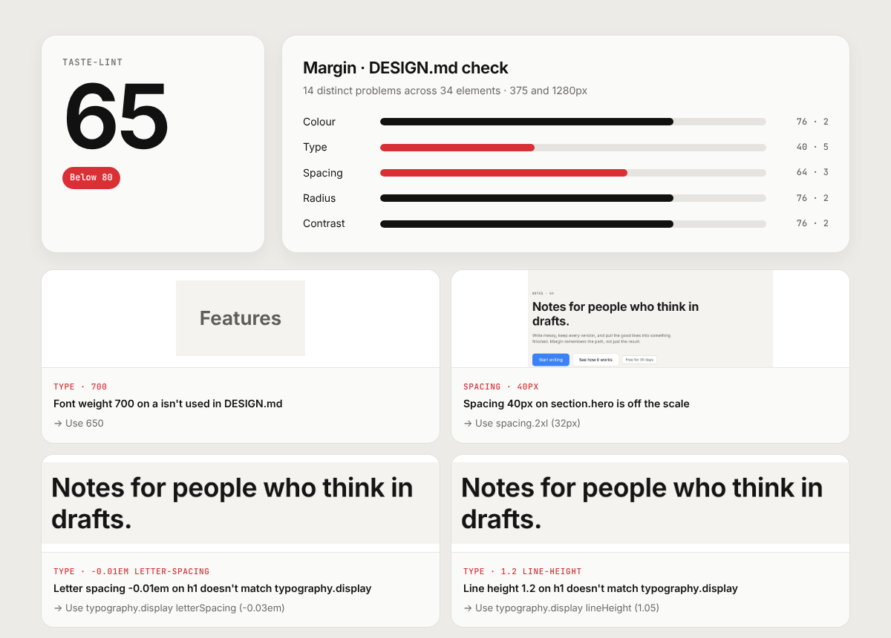

# taste-lint



**A Claude Code plugin that screenshots your UI and grades it against your DESIGN.md: off-palette colours, off-scale spacing, rogue corner radii, type drift and contrast, delivered as a report card with fixes.**

Google's [DESIGN.md](https://github.com/google-labs-code/design.md) is becoming the standard way to tell agents how a product looks. Its linter checks that the file is valid. Nothing checked that the shipped page actually follows it, until now.

## What you get

- **A score out of 100**, with a bar for each category: colour, type, spacing, radius and contrast.
- **Phone and desktop in one run.** `--widths 375,1280` checks both, and marks problems that only happen on one screen size.
- **Every distinct problem with a cropped screenshot** of where it happens, and the token to use instead. For example "Off-palette background #3B82F6 on the button → use colors.accent".
- **A look pass:** Claude also reads the prose rules in DESIGN.md (hierarchy, tone, "accent only for the primary action") and scores them separately, so the main number stays reproducible.
- **Safe fixes:** `/taste-lint fix` swaps literal values for the right tokens, lists anything that needs judgment, and re-runs to show the new score.
- **Skips what isn't yours.** Mark a chat widget or embed with `data-taste-lint-ignore`, or pass `--ignore "iframe"`.
- **CI:** exit code 1 below your threshold, plus `report.json`.

## Install

**Claude Code plugin**

```
/plugin marketplace add eb-ekeledo/taste-lint
/plugin install taste-lint@taste-lint
```

Then in any project with a DESIGN.md:

```
/taste-lint http://localhost:3000
/taste-lint http://localhost:3000 fix
```

**Command line**

```bash
git clone https://github.com/eb-ekeledo/taste-lint && cd taste-lint
npm install && npx playwright install chromium
node scripts/measure.js --design path/to/DESIGN.md --url http://localhost:3000 --out taste-lint
```

Options: `--html page.html` for a static file, `--routes /,/pricing`, `--widths 375,1280`, `--ignore ".chat-widget"`, `--threshold 80`.

## How it scores

| Category | Rule | Weight |
| --- | --- | --- |
| Colour | Every solid colour within Delta E 2.3 of a `colors` token | 25 |
| Type | Family, size, weight, line height and letter spacing from `typography` | 25 |
| Spacing | Padding, vertical margins and gaps on the `spacing` scale | 20 |
| Radius | Corners from `rounded` (pills allowed with a `full` token) | 10 |
| Contrast | Text meets WCAG AA | 20 |

Each distinct problem costs 12 points in its category. Token references like `{colors.accent}` are followed, and broken ones are reported as DESIGN.md warnings. It measures what the browser actually renders (computed styles), so it works with any stack: CSS, Tailwind, CSS-in-JS, any framework.

## Try it on the examples

```bash
node scripts/measure.js --design examples/DESIGN.md --html examples/drifted/index.html --widths 375,1280 --out out
```

[`examples/`](examples) has a DESIGN.md for a fictional notes app, a page that follows it (scores 100) and a drifted copy with 13 planted problems (scores 65), one of which only shows up on a phone. There's also a [GitHub Action](examples/github-action.yml) to copy into your project.

## Quality

```bash
node scripts/check.js
```

The clean page must score 95 or more, all 13 planted problems must be found with at most 1 other finding, the ignored widget must never be reported, token references must resolve, and two runs must give identical results. See [`evals/`](evals) for trigger tests and the comparison plan.

## Part of a set

Tools for designers who build in Claude:

- [**feel-skill**](https://github.com/eb-ekeledo/feel-skill): feel words to values
- [**state-sheet-skill**](https://github.com/eb-ekeledo/state-sheet-skill): every state of a component on one review sheet
- **taste-lint:** grades your UI against your DESIGN.md (this repo)

Made by [Ebere](https://ebere.design). MIT licensed.
